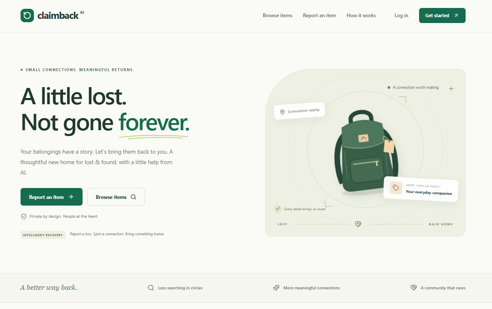
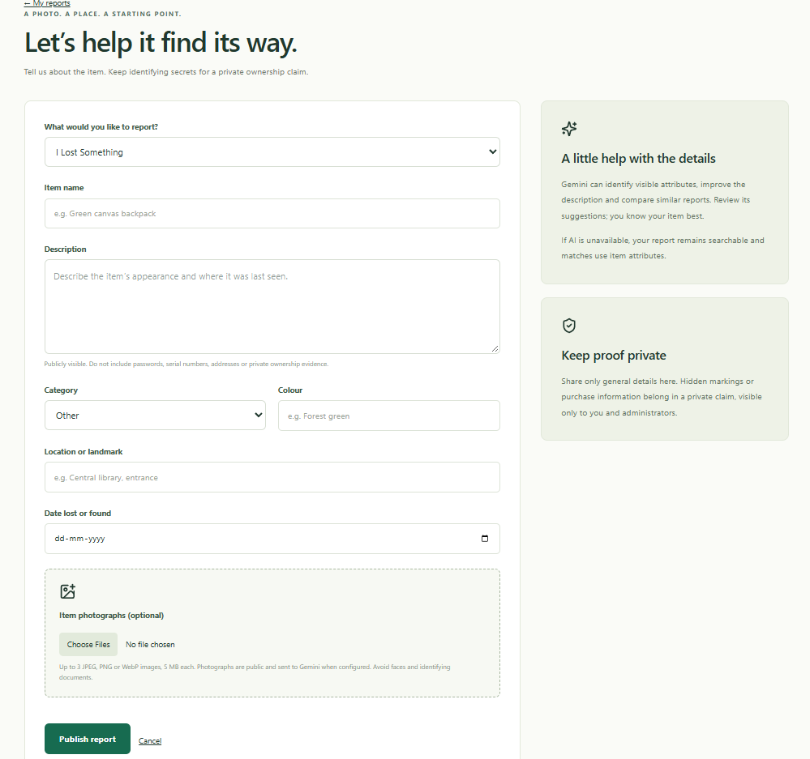
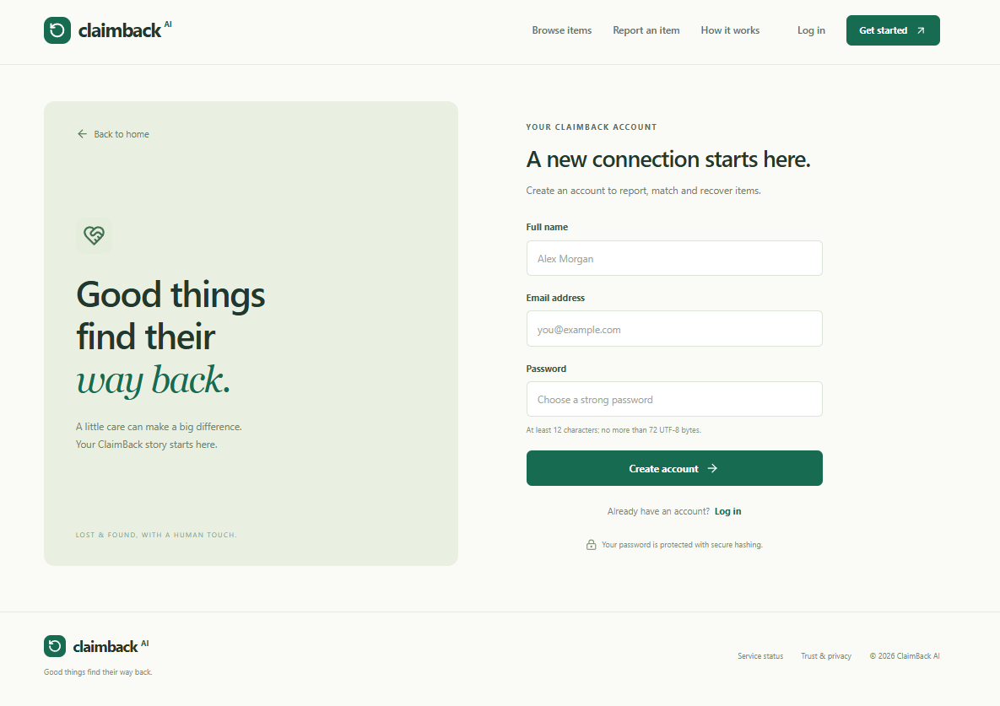

<h1 align="center">ClaimBack AI</h1>

AI-assisted lost &amp; found, with human ownership verification.

  <a href="https://claimback-dusky.vercel.app/"><strong>Explore the live application →</strong></a>
  &nbsp;·&nbsp;
  <a href="#screenshots">Screenshots</a>
  &nbsp;·&nbsp;
  <a href="docs/ARCHITECTURE.md">Architecture</a>

  
  
  

ClaimBack AI is a full-stack lost-and-found platform that connects item reporting, AI-assisted discovery and verified recovery. Users publish reports with photographs, review ranked suggestions and submit private ownership claims. Administrators assess the evidence and record the handover.

Gemini is integrated into the reporting and matching workflow: it interprets item photographs, extracts structured attributes, enhances descriptions and compares candidate reports. **Similarity suggests a connection; it never proves ownership.**

## Live application

| Component | Link | Hosting |
| --- | --- | --- |
| Frontend | [claimback-dusky.vercel.app](https://claimback-dusky.vercel.app/) | Vercel |
| Backend API | [claimback-api.onrender.com](https://claimback-api.onrender.com/) | Render |
| API health | [Health endpoint](https://claimback-api.onrender.com/api/v1/health) | Render |
| API readiness | [Readiness endpoint](https://claimback-api.onrender.com/api/v1/health/ready) | Render |

The backend link is the service base URL; application endpoints are under `/api/v1`. Readiness checks database connectivity, while provider availability is handled during uploads and analysis.

## Key features

- **Lost and found reports:** photographs, report editing, search, category/location/date filters and pagination.
- **Gemini item understanding:** structured attributes, enhanced descriptions and owner-correctable AI suggestions.
- **Ranked matching:** semantic comparison combined with item attributes, explanations, cached results and a non-AI fallback.
- **Ownership and recovery:** private evidence, independent administrator approval or rejection, confirmed handover and recovery history.
- **User workspace:** personal reports, claims, suggested matches and in-app notifications.
- **Administration:** claim review, report moderation, user suspension/reactivation and recovery statistics.
- **Responsive interface:** layouts for desktop and mobile, with loading, empty, success and error states.

## Screenshots

<table align="center">
  <tr>
    <td align="center" width="50%">
      
       <strong>Homepage</strong>
    </td>
    <td align="center" width="50%">
      
       <strong>Report details · Gemini item understanding</strong>
    </td>
  </tr>
  <tr>
    <td align="center" width="50%">
      
       <strong>Report submission form</strong>
    </td>
    <td align="center" width="50%">
      
       <strong>AI-powered item analysis and matching</strong>
    </td>
  </tr>
  <tr>
    <td align="center" colspan="2">
      
       <strong>Registration</strong>
    </td>
  </tr>
</table>

## Tech stack

| Layer | Technologies |
| --- | --- |
| Frontend | React, Vite, React Router, Tailwind CSS, Axios, Lucide icons |
| Backend | Node.js, Express, REST APIs |
| Database | MongoDB Atlas, Mongoose |
| AI | Google Gemini through the backend-only `@google/genai` SDK |
| Image processing | Cloudinary, Multer, Sharp |
| Authentication & validation | JWT, bcrypt, Zod, Helmet, CORS, rate limiting |
| Testing | Node.js test runner, Supertest, MongoDB Memory Server |
| Hosting | Vercel frontend, Render backend |

## Architecture and workflow

~~~mermaid
flowchart LR
    Client[React frontend] -->|REST API + session cookies| API[Express backend]
    API --> DB[(MongoDB Atlas)]
    API --> AI[Gemini analysis and ranking]
    API --> Images[Cloudinary image storage]
~~~

1. **Report:** an authenticated user submits an item. The backend validates and normalizes photographs, stores them in Cloudinary and requests Gemini analysis.
2. **Discover:** validated attributes support search and matching. A bounded candidate shortlist is compared semantically; cached results reduce repeated provider calls. Attribute-based matching remains available when AI fails.
3. **Claim:** a user submits private ownership evidence for a found item, optionally linking their lost report.
4. **Recover:** an independent administrator reviews the evidence and confirms handover. MongoDB transactions keep claim history, linked report states and recovery notifications consistent.

AI output is validated before persistence. The interface identifies unavailable analysis explicitly rather than presenting fallback results as Gemini output.

## Security highlights

- Passwords are hashed with bcrypt; JWT sessions use HttpOnly cookies and Secure cookies in production.
- Backend role and ownership checks protect administrator actions and report updates. Logout and suspension revoke existing sessions.
- Private ownership evidence is restricted to the claimant and administrators. It is never sent to Gemini or included in public reports.
- Uploads undergo file-size limits, actual image decoding, normalization and metadata removal.
- Request validation, origin checks, rate limits and security headers protect API boundaries. Provider credentials stay on the backend.

## Run locally

### Prerequisites

- Node.js **22.12+** and npm.
- MongoDB Atlas or a MongoDB replica set; claim and recovery operations use transactions.
- Gemini and Cloudinary credentials for the complete AI and image-upload workflow.

### 1. Install dependencies

From the repository root:

~~~sh
npm ci
~~~

### 2. Configure the environment

Create `server/.env` from [server/.env.example](server/.env.example) and `client/.env` from [client/.env.example](client/.env.example). Preserve existing configuration if these files already exist.

| Backend variable | Purpose |
| --- | --- |
| `MONGODB_URI` | Connection string selecting the intended `claimback` database |
| `JWT_SECRET` | Stable application secret of at least 32 bytes |
| `GEMINI_API_KEY` | Gemini API access; backend only |
| `GEMINI_MODEL` | `gemini-3.5-flash-lite`, the model verified with this project |
| `CLOUDINARY_CLOUD_NAME` | Cloudinary cloud name |
| `CLOUDINARY_API_KEY` | Cloudinary API access |
| `CLOUDINARY_API_SECRET` | Cloudinary API secret; backend only |
| `CLIENT_ORIGIN` | Exact permitted frontend origins |

For local development, retain the template defaults: backend port `5000`, frontend port `5173`, `COOKIE_CROSS_SITE=false` and `TRUST_PROXY=0`. The client uses `VITE_API_URL=/api/v1`; Vite proxies `/api` to `http://127.0.0.1:5000`.

Keep `MONGODB_DNS_SERVERS` unset unless a diagnosed DNS issue requires it. Never place provider or database secrets in a `VITE_` variable or commit `.env` files.

### 3. Start both servers

~~~sh
npm run dev
~~~

Open `http://127.0.0.1:5173`. The backend health endpoint is `http://127.0.0.1:5000/api/v1/health`. The root command runs both workspaces; leave it running while using the application. The development backend watches source files and `server/.env` for changes.

Without Gemini configuration, reports use explicit non-AI fallbacks. Without Cloudinary configuration, text-only reports remain available and image uploads return an error.

### Administrator access

Administrators use the **normal login page**, then **Dashboard → Administration** at `/admin`. An authorized operator assigns the admin role using the existing `admin:grant` script; sign in again after assignment. There is no separate admin login, public role-assignment endpoint or default administrator account. See the [deployment guide](docs/DEPLOYMENT.md) for environment and administrator setup considerations.

## Tests and production build

| Command | Purpose |
| --- | --- |
| `npm test` | Run backend tests |
| `npm run build` | Build the frontend into `client/dist` |
| `npm run check` | Run the backend suite and frontend build |

Automated tests use isolated temporary MongoDB instances, including replica sets for transaction coverage. Remote AI and image-storage services are mocked in these tests; passing them does not establish live provider availability.

## Documentation

- [API reference](docs/API.md) — routes, request contracts and authorization.
- [Architecture](docs/ARCHITECTURE.md) — service boundaries, matching strategy and data lifecycle.
- [Deployment guide](docs/DEPLOYMENT.md) — environment variables, Atlas access, CORS and cookies.
- [Render configuration](render.yaml) and [Vercel configuration](vercel.json) — hosting configuration for the backend and frontend.
