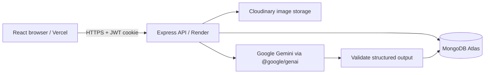

# ClaimBack AI architecture

## Scope and milestones

This repository starts with a tested foundation, as requested in the first-execution instructions. It is not yet a complete recovery platform. Do not present planned capabilities as shipped features.

1. **Foundation (implemented):** npm workspaces, Express API, validated configuration, MongoDB lifecycle, React/Vite/Tailwind, public landing page, reusable components, live service status, security middleware, error contract, deployment examples, and tests.
2. **Identity (implemented):** registration, login, logout, current session, profile updates, password hashing, JWT cookies, authenticated routes, and backend role guard. No public admin registration.
3. **Reports (next):** real CRUD, public browsing with search/filter/pagination, detail pages, Cloudinary photo uploads, owner authorization, moderation, and upload tests.
4. **Image understanding:** backend-only Gemini adapter, structured output validation, user-editable attributes, bounded image handling, persisted analysis state, timeout/quota fallback, and tests.
5. **Smart matching:** indexed candidate retrieval, deterministic ranking, one bounded semantic comparison call, explanations, cached results, interest actions, and tests.
6. **Claims and recovery:** private evidence, admin review, audited transitions, exclusive approval, confirmed handover, notifications, and authorization/race-condition tests.
7. **Dashboards and release:** database-backed statistics, reports/matches/claims/recovery views, admin analytics and management, accessibility/browser testing, Atlas/Cloudinary/Gemini smoke tests, and deployment.

Test each milestone before progressing. Do not populate production with demo reports or invented metrics. The current account page contains actual session information, not dashboard statistics.

## System



One backend service is sufficient. Browser requests never receive service credentials. MongoDB holds application data; Cloudinary holds bounded image uploads. Gemini enriches reports and suggests similarity; only humans decide claims. API controllers handle HTTP concerns; services own workflows; models enforce persistence rules; middleware handles authentication, authorization, validation, and failures.

## Layout

```text
client/
  public/                 Local brand assets
  src/
    components/           Shared layout, feedback and route guards
    contexts/             Session and toast state
    lib/                  Axios and API error helpers
    pages/                Landing, auth, account and service status
    App.jsx               React Router routes
    styles.css            Tailwind and design system
server/
  src/
    config/               Environment and database lifecycle
    controllers/          HTTP request handlers
    middleware/           Auth, origin protection, validation, errors
    models/               User, Report, Match, Claim, Notification
    routes/               Versioned routers
    services/             Identity logic; future AI/upload/workflows
    utils/                Errors and structured logging
    app.js                Express factory (no listening side effect)
    server.js             Startup and graceful shutdown
  test/                   HTTP integration and security tests
docs/                     Architecture and API contracts
```

## Data design

All collections have timestamps. Public endpoints must use explicit response projections; never serialize arbitrary documents.

| Collection | Core fields | Indexes / invariants |
| --- | --- | --- |
| User | name, normalized email, passwordHash (excluded by default), role, status, tokenVersion | Unique email; public registration assigns user role; suspended accounts cannot authenticate |
| Report | owner, type lost/found, title, description, category, colour, location, occurredAt, images, status, moderation, analysis | Owner/createdAt; type/status/moderation/category/date; location; text search; image count bounded; public serializer excludes owner identifiers and image public IDs |
| Match | source, candidate, score, explanation, method, algorithmVersion, interestedBy, expiresAt | Unique directed pair; source/score; TTL expiry; score is similarity 0–100 |
| Claim | report, claimant, privateEvidence, status, history, reviewedBy, handoverAt | Claimant/date; report/status; unique report/claimant; at most one approved or handed-over claim per report via partial unique index |
| Notification | recipient, kind, title, message, href, readAt | Recipient/readAt/createdAt; never include private claim evidence |

Private evidence is in the Claim collection and excluded by default. Only the claimant and authorized administrators may request it through explicit projections. Finders do not automatically receive private claimant evidence. History is server-authored. Ownership changes, review decisions, and handovers must use transactions on Atlas so claims and reports stay consistent.

Report model and other workflow models are foundations, not active HTTP features yet. Their authorization, indexes on Atlas, and workflow invariants require integration validation in their respective milestones. Production disables automatic index creation: use a reviewed index migration before enabling new workflows.

## Identity and security

- bcrypt with cost 12; passwords 12–72 UTF-8 bytes (avoid bcrypt truncation).
- JWT signed with HS256, issuer/audience checked, fixed expiry, user ID as subject, token version checked against database on each protected request.
- JWT stays in an HTTP-only cookie, never localStorage. SameSite=Lax locally; explicitly set SameSite=None + Secure for separate Vercel/Render origins.
- Every modifying API request must carry an exact allowed Origin and `X-Requested-With: ClaimBack` header. This prevents cross-origin form requests and forces a CORS preflight for cross-site clients. `CLIENT_ORIGIN` is an explicit allowlist; no wildcard credentials.
- Cookie has no Domain attribute and its path is restricted to `/api/v1`. Logout clears the cookie and increments tokenVersion, revoking all sessions for that user.
- Authentication limits are stricter than general API limits. The initial in-memory limiter is per instance; add a shared store before horizontal scaling.
- Helmet, bounded JSON body, request IDs, structured logs, centralized errors, whitelisted input fields, and no raw Mongo operators from client requests.
- Trust proxy is explicit (0 locally, 1 on Render). Logs exclude passwords, cookies, API keys, evidence, database URIs, and request bodies.
- No emailed password reset or email verification yet; add before public production use. MFA and stronger abuse controls are release-hardening considerations.

## AI and matching design (future milestone)

Use the official `@google/genai` SDK exclusively on the server. Configure a supported model through `GEMINI_MODEL` when implementing and validating the integration. Never silently choose a retired model.

1. Validate upload count, byte size, file signatures and actual decoded dimensions. Strip metadata and normalize the image. Upload via the backend to a controlled Cloudinary folder, with compensating cleanup on persistence failure.
2. Send bounded image bytes and public report description to Gemini with an explicit schema: object, category enum, colours[], brand (nullable), characteristics[], distinctiveFeatures[], keywords[], improvedDescription. Treat image/text instructions as untrusted data; never include private evidence or credentials.
3. Parse JSON and validate lengths, arrays and enums with Zod. Persist valid attributes and analysis provenance. On timeout, malformed output, missing key or quota failure, persist the original report with `analysis.status = unavailable` and allow retry. Users can correct attributes without losing originals/provenance.
4. Retrieve at most 50 opposite-type, open, visible reports with indexed category/date/location filters. Exclude self-owned reports. Use a date window and tolerate unknown category so extraction errors do not eliminate plausible matches.
5. Score category, colour, feature/keyword overlap, description, date proximity and location. Keep at most 8 candidates. Compare these in **one** bounded Gemini call, not one per item. Validate candidate IDs, score range and explanations; reject unexpected IDs or duplicates.
6. Combine deterministic (40%) and semantic (60%) similarity when valid; otherwise use deterministic ranking. Cache directed results for 24 hours, invalidate after report edits, cap refreshes per user/report, and persist algorithm version.
7. Display “similarity, not proof of ownership.” Expressing interest creates a notification; it never approves a claim.

## Claim state machine (future milestone)

`pending → approved | rejected | withdrawn`; `approved → handed_over | rejected` (cancellation requires reason). Final states cannot be silently overwritten. A pending claim requires a visible open found report, an authenticated claimant other than the finder, and bounded private evidence. Approval must atomically reserve the report and reject/resolve competing claims. Handover must be explicitly confirmed by an authorized human and audited. Suspensions and moderation must prevent new actions on affected content.

## Deployment

Frontend: Vercel, repository root, install `npm ci`, build `npm run build`, output `client/dist`. `vercel.json` handles client-side routing. Configure `VITE_API_URL=https://YOUR-API.onrender.com/api/v1` at build time.

Backend: Render Node service with repository root, build `npm ci --omit=dev`, start `npm start`; health `/api/v1/health/ready`. Set production secrets, one trusted proxy and exact frontend origin. `render.yaml` is a starting blueprint. Cross-site browser cookie restrictions can affect separate domains: a shared parent domain (app.example.com/api.example.com) is preferable for the final release.

Database: Atlas, dedicated least-privilege database user and restricted network access. Never commit credentials. Free-tier quotas, sleeping services and provider availability must be checked before deployment. No deployment occurs in this foundation milestone.

## Documentation references

- [Tailwind's Vite integration](https://tailwindcss.com/docs/installation/using-vite)
- [Official Google Gen AI JavaScript SDK](https://googleapis.github.io/js-genai/)
- [Gemini structured output](https://ai.google.dev/gemini-api/docs/structured-output)
