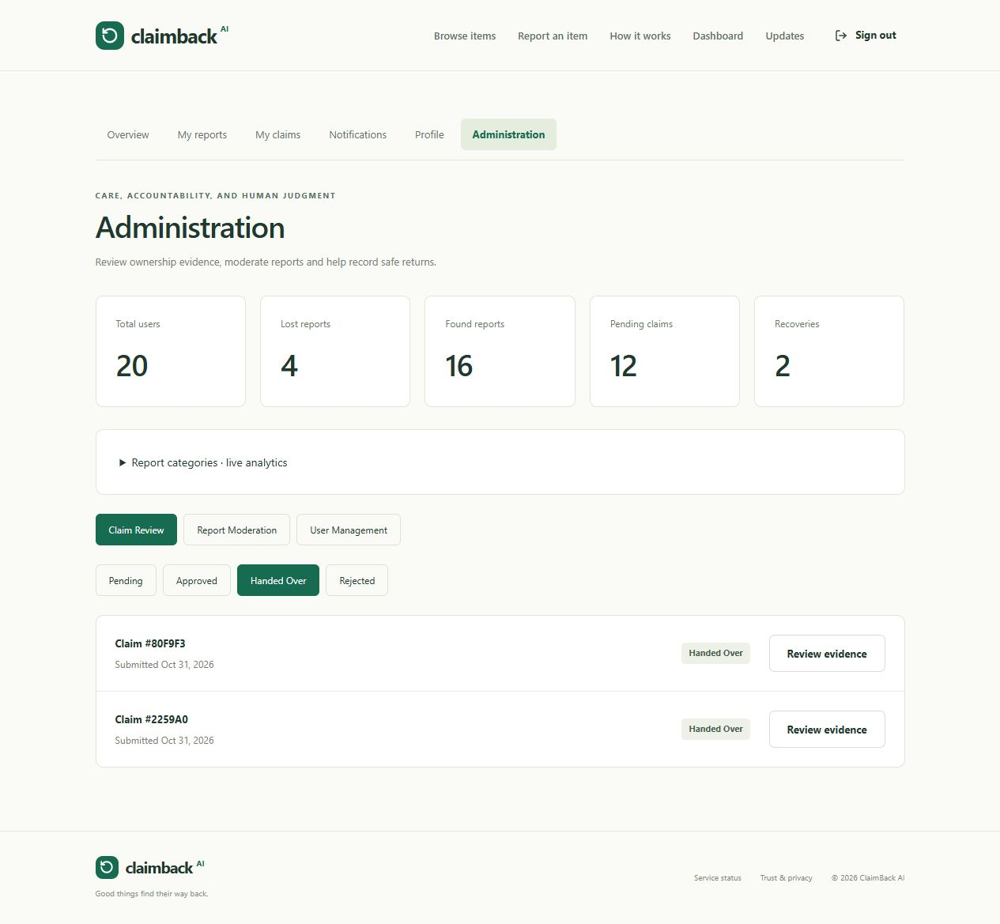

# Final application and administrator verification — 1 November 2026

The existing implementation is preserved. Administrator verification, persistence checks, guarded cleanup and the final root `npm run check` are complete. No public deployment, new feature, redesign, API-key change or provider/database configuration change was made during this final pass.

## Final test results

| Check | Result |
| --- | --- |
| Root `npm run check` | Exit 0 |
| Backend suite | 44 tests passed; 0 failed |
| Frontend production build | Passed; 1,670 modules |
| Build output | JS 389.62 kB / gzip 125.33 kB; CSS 34.36 kB / gzip 8.60 kB |
| Frontend HTTP | 200 at `http://127.0.0.1:5173/` |
| Readiness HTTP | 200 at `http://127.0.0.1:5000/api/v1/health/ready`; Atlas connected |
| Environment | Required local backend values present; stable JWT secret; model `gemini-3.5-flash-lite` |
| Production validation | HTTPS-origin configuration parsed successfully; Secure, HttpOnly, SameSite=None cookies for cross-site mode; trust proxy 1 |
| Frontend secret scan | None of the actual Atlas URI, JWT secret, Gemini key or Cloudinary API secret occurred in built JS/CSS |
| Browser | Live status refresh and preserved Gemini report/image rendered; final status-page console capture had no errors/warnings |

Production validation used an in-memory configuration with a reserved example HTTPS origin. It did not change the local environment or configure a real remote deployment.

## Administrator procedure and tested controls

1. Open `http://127.0.0.1:5173/login` and use the normal credentials of an active account with role `admin`.
2. Open Dashboard, then **Administration** in the workspace navigation.
3. The exact dashboard URL is `http://127.0.0.1:5173/admin`.

There is no separate admin login. The permanent administrator present during the resumed session was preserved; no existing account was promoted or demoted.

| Area/control | Actual verification |
| --- | --- |
| Login and navigation | Synthetic administrator used normal login and Administration link; anonymous `/admin` redirected to `/login` |
| Regular-user frontend access | `/admin` redirected to `/account`; Administration link absent |
| Admin APIs | Anonymous GETs returned 401; regular-user GETs and mutation attempts returned 403 |
| Private claim evidence | Administrator could inspect the synthetic evidence; unrelated finder received 404; lists excluded private evidence/history |
| Claim review | Pending/Approved/Handed Over/Rejected filters, Review evidence and View item report worked |
| Approval | Required note validated; saved transition `pending → approved` |
| Handover | Required confirmation checkbox validated; saved `approved → handed_over`; linked lost/found reports became recovered |
| Rejection | Separate synthetic claim saved `pending → rejected` |
| Moderation | Inspect report expanded; Hide/Restore and Cancel worked; reason required; hidden public GET 404, restored GET 200 |
| User management | Search, Suspend/Reactivate and Cancel worked; old sessions revoked; suspended login denied with generic 401; fresh login succeeded after reactivation |
| Admin protection | Administrator suspension control intentionally disabled; API rejected it with 409 `USER_PROTECTED` |
| Pagination | Next/Previous tested with sufficient synthetic records in claims, reports and users |
| Statistics | User/lost/found/pending/recovery cards and category analytics loaded; recovery count increased after handover |
| Notifications/history | Claim, recovery and moderation updates persisted for synthetic participants |

**Where to act:** `/admin` → Claim review → Pending → Review evidence → enter a review note → Approve claim or Reject claim. After approval, enter a handover note, confirm the actual handover checkbox and select Record handover. Moderation is under Report moderation; suspension/reactivation is under User management.

The resumed readback re-confirmed saved claim states/history, recovered linked reports, visible restored moderation and the reactivated synthetic owner. Fresh login/read APIs and denied mutation probes confirmed authorization before cleanup. Already successful UI/provider work was not unnecessarily replayed.

## Actual issue fixed

`client/src/pages/AdminPage.jsx` previously used `window.prompt()` for moderation. The in-app browser threw `prompt() is not supported`, so the Hide action never reached the API. Moderation and account-status confirmations now use in-page forms with an explicit target, required reason where applicable, confirm/cancel controls, busy state and visible errors. Existing endpoints, roles, validation and styling remain in use.

The revised controls passed live browser tests against Atlas. A fresh tab after the fix had no errors/warnings. An earlier verification probe coincided with a dev-server restart and was retried successfully once readiness returned; it was not treated as an authorization or persistence failure.

## Temporary data cleanup

Only the exact records in the saved `ADMIN-VERIFY-76cc64c0` fixture manifest were eligible. Guards checked IDs, synthetic names/emails/titles, creation time, ownership and references. No fixture had an uploaded photograph; Cloudinary deletion was not needed or performed.

| Collection | Created for interrupted admin verification | Removed in final cleanup |
| --- | --- | --- |
| Users | 13: temporary admin, owner, finder and 10 pagination accounts | 13 |
| Reports | 14: 13 found fixtures and a linked lost fixture | 14 |
| Claims | 13 synthetic claims | 13 |
| Notifications | 10 related synthetic notifications present at cleanup | 10 |
| Matches | 0 created by this admin-only fixture setup | 0 |

Deletion ran in one Atlas transaction after confirming a distinct permanent active administrator existed and that no outside reports/claims/matches referenced the target fixtures. Before/after snapshots of all non-target records matched. Remaining collection counts were 8 users, 8 reports, 2 claims, 3 matches and 12 notifications. The permanent administrator, real account and earlier Gemini/Cloudinary verification records were preserved. No uncertain records were deleted or identified.

A detailed cleanup manifest is retained locally and excluded from the public repository. Temporary passwords and cookies were removed from the ignored local fixture state. Prior verification records such as the Gemini-analyzed reports `6ae60d8ce7c79c6b999af6fb` and `6ae60d90e7c79c6b999af704` remain intact; the first was opened in the browser again after cleanup.

The synthetic fixture setup used actual Atlas model inserts for pagination/admin test data, not Gemini output. Subsequent admin operations used the real browser/API. No private evidence is reproduced here or in the screenshot.

## Main journey and evidence boundaries

Registration/login, lost/found uploads, Gemini analysis/enhancement, semantic suggestions, notifications, ownership claims, independent admin review, approval, handover and recovery have connected implementation and successful verification evidence. The source review found real API handlers for the core actions rather than placeholder buttons.

- Earlier [live provider verification](LIVE_PROVIDER_VERIFICATION.md) established real Cloudinary storage/replacement/deletion and the actual Atlas recovery workflow.
- [Gemini Flash-Lite verification](GEMINI_FLASH_LITE_VERIFICATION.md) established six successful real generation calls, including persisted image analysis and a 93/100 Gemini-assisted hybrid match.
- This admin pass exercised live browser/API mutations, access restrictions and persistence, followed by a fresh isolated regression suite and build.
- The final pass reused those successful provider results; it did not make new Gemini calls or create new Cloudinary assets. Automated tests use mocked remote providers and an isolated database, not the user's Atlas records.

## Exact release-file changes in this final admin work

- `client/src/pages/AdminPage.jsx`: functional in-page confirmation forms replacing native prompt/confirm flows.
- `README.md`: admin navigation and final verification links.
- `docs/DEPLOYMENT.md`: explicit production variables, ordered Render/Vercel steps and remaining hosted checks.
- `docs/FINAL_VERIFICATION.md`: this report.
- `docs/ADMIN_CLEANUP_MANIFEST.json`: safe exact-ID cleanup record.
- `docs/admin-verification.png`: successful admin dashboard capture before temporary fixtures were removed.

Ignored operator artifacts were also updated/created under `test-results/admin-verification` (`run.mjs`, `finalize.mjs`, sanitized state) and `test-results/final-config-check.mjs`. They are not production code or committed credentials. `render.yaml`, `vercel.json`, environment values and provider/database modules were inspected but unchanged in this final pass.

## Deployment readiness and remaining limitations

Follow [DEPLOYMENT.md](DEPLOYMENT.md) for exact commands/settings. No known blocking application regression remains in the tested core workflow. Hosted readiness is conditional on final HTTPS origins, backend-only secrets, Atlas access for Render outbound ranges, index initialization and deployed cookie/provider smoke tests. No public deployment was performed.

Separate Vercel/Render sites can encounter third-party-cookie blocking. Render's configured Free plan has idle spin-down/cold starts that can exceed the frontend timeout. Provider quotas/availability remain external. Failed Cloudinary deletions require operator follow-up; there is no durable background retry worker. Email changes/verification and password-reset flows are not implemented; the disabled email field explicitly states this, and they were not added in this no-new-features pass. No load test or independent security audit was performed.

Both development servers were left running. The development environment, production-shape validation and local provider results must not be described as verification of an already-deployed production service.

