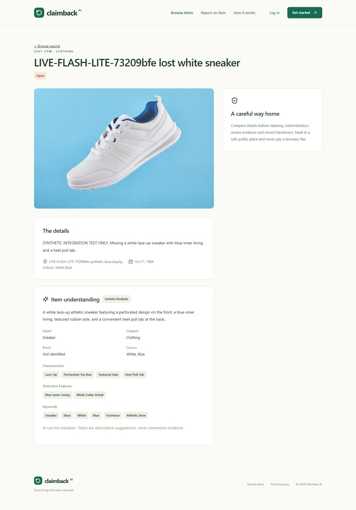

# Gemini 3.5 Flash-Lite live verification — 31 October 2026

**Passed: real generation, image understanding, validated structured extraction, description enhancement and ClaimBack semantic matching.** The backend now uses `gemini-3.5-flash-lite` with the existing API key ending `KPaw`.

Google documents this model on its [official model page](https://ai.google.dev/gemini-api/docs/models/gemini-3.5-flash-lite). Access was also checked directly with the configured key; documentation alone was not treated as proof of availability.

## Pre-switch tests: actual provider calls

These checks used the existing `@google/genai` 1.52.0 SDK, official Gemini endpoint, explicit existing API key, normal TLS validation and the application's 20-second timeout. The configured model remained `gemini-3.8-flash` throughout these preliminary tests; only the diagnostic client's request model differed.

| Live check | Result |
| --- | --- |
| Model metadata | Succeeded in 271 ms; `models/gemini-3.5-flash-lite` advertised `generateContent` |
| One minimal text request | Succeeded in 2,270 ms; exact response `CLAIMBACK_OK` |
| Photograph understanding | Succeeded in 3,114 ms; identified a white-and-blue athletic shoe with white laces against a blue background |
| ClaimBack structured extraction | Succeeded in 2,160 ms through the actual `createAI().analyze()` service; JSON parsed and passed the existing strict Zod schema |

The photograph was the same public, non-sensitive sneaker sample used in prior verification, normalized by ClaimBack before transmission. Extracted fields included object `shoe`, category `clothing`, colours `white` and `blue`, lace-up construction, perforations, textured sole, mesh collar, blue lining and heel pull tab. Unknown brand remained empty. An enhanced description was returned successfully.

Only after all four checks passed was the single `GEMINI_MODEL` line in `server/.env` changed to `gemini-3.5-flash-lite`. The development watcher restarted the backend. Its startup log confirmed the new model and key suffix `KPaw`, followed by `database_connected` and `server_listening`.

## Running ClaimBack workflow: actual providers and Atlas

Run label: `LIVE-FLASH-LITE-73209bfe`.

Two fresh synthetic accounts registered through the real application API. Each posted an actual photograph through `http://127.0.0.1:5173/api/v1/reports`, exercising Vite's proxy, authentication, image normalization, real Cloudinary upload, real Gemini calls and Atlas persistence. The synthetic event date was 31 October 1984, with a verified empty surrounding date window to avoid matching unrelated reports.

| Report | ID | Persisted analysis |
| --- | --- | --- |
| Lost sneaker | `6ae60d8ce7c79c6b999af6fb` | `complete`, model `gemini-3.5-flash-lite` |
| Found sneaker | `6ae60d90e7c79c6b999af704` | `complete`, model `gemini-3.5-flash-lite` |

Both reports received image-derived attributes and enhanced descriptions. The found report returned a **93/100 hybrid score**, with **`method: gemini`**, against the synthetic lost report. The actual provider-generated explanation was:

> Both items are white sneakers with blue lining, white laces/lace-up design, and a rear pull tab/loop, sharing the exact same location and date.

The displayed score uses the existing 70% semantic / 30% deterministic combination; it is not claimed to be the raw Gemini score or proof of ownership. Atlas readback confirmed both completed analyses and one persisted Gemini match in the actual `claimback` database. A `match` notification titled `A possible match` also persisted.

The browser displayed **Gemini Analysis**, the enhanced description and extracted attributes. The real Cloudinary image loaded at 1600 pixels wide. The captured browser console contained no errors or warnings.

## Data handling and scope

- Existing API key, SDK version, architecture and fallback behavior preserved.
- No new key, billing change, MongoDB URI/DNS/TLS change or Cloudinary configuration change.
- No private ownership evidence sent to Gemini.
- The two new synthetic accounts were suspended and their sessions revoked after verification. No administrator role was needed.
- Both clearly labelled synthetic reports and their two uploaded images remain available for review. Their credentials were kept only in process memory, not written to the result file.
- A before/after audit of pre-existing application record IDs and `updatedAt` values found no changes. No existing report was re-analyzed or rewritten.

Historical reports with persisted `AI unavailable` results keep that state. Changing the selected model does not automatically reprocess old records. The new reports demonstrate successful current behavior without modifying historical data.

## Files and verification boundary

- `server/.env` (ignored): only the selected model value changed.
- `test-results/flash-lite/verify.mjs` and `integration.mjs` (ignored): explicit operator-run live checks and safe result files; no production module changes.
- This report, README/status notes and `docs/gemini-flash-lite-live.png`: current verification evidence.

This run completed **six successful real generation calls**: minimal text, standalone photograph understanding, structured service extraction, two application report analyses and one application semantic-ranking batch. Model metadata retrieval was a separate successful call. No model response or provider transport was mocked.

The previous full automated backend suite passed 44 tests. It was not rerun for this model-only configuration change; its mocked provider success paths are separate evidence and were not used to claim live success. No frontend source or SDK dependency changed.

Frontend and backend remain running on ports 5173 and 5000, respectively. Atlas remains connected to `claimback`. The original Gemini 3.8 capacity errors are historical findings, not the current model's verification result.

