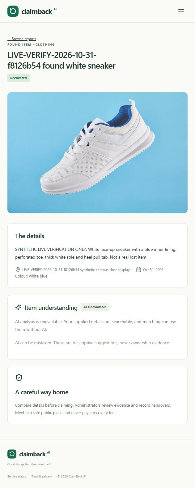

# Live provider verification — 31 October 2026

Cloudinary and the actual Atlas recovery workflow passed live verification. Gemini credentials authenticated model metadata requests, but content generation did **not** succeed. This is not a successful end-to-end AI demonstration yet.

## Verification boundaries

| Area | Result | Evidence |
| --- | --- | --- |
| Live Gemini | Incomplete / generation failed | Real model listing and metadata retrieval succeeded; real image, text and ranking calls failed with provider errors |
| Live Cloudinary | Passed | Application uploads, provider resource lookup, browser delivery, replacement, deletion and failure cleanup |
| Actual MongoDB Atlas | Passed | Synthetic registration, login, reports, private claim, administrator approval, handover, recovery history and notifications persisted in `claimback` |
| Automated backend suite | Passed | `npm test`: 44 passed, 0 failed; includes isolated database tests and mocked AI/storage success and failure scenarios |
| Frontend production build | Passed | `npm run build`: 1,670 modules; JavaScript 388.65 kB / gzip 125.15 kB; CSS 34.36 kB / gzip 8.60 kB |
| Browser | Passed for exercised workflow | Landing/report pages and real image rendered; administrator approval/handover completed; final captured console contained no errors or warnings |

Mocked provider tests establish application behavior; they do not establish live Gemini availability. Live workflow actions used the running application through Vite's `/api` proxy, not the isolated automated test database.

## Gemini: configuration corrected; generation still unavailable

- Backend configuration loads `server/.env`. The Gemini key was present and never printed. Model-list and model-metadata requests authenticated successfully.
- The original model value was `3.8-flash`; a real generation request returned 404. The provider's model list advertised `models/gemini-3.8-flash`.
- Changed only `GEMINI_MODEL` to `gemini-3.8-flash`, then restarted the backend. A metadata GET for that model succeeded and advertised `generateContent` support.
- Real report photographs were submitted to the application's Gemini analysis service. Calls failed with 503/504 and the application stored `analysis.status: unavailable`.
- A bounded diagnostic with a 45-second deadline also failed with 503 after about 3.7 seconds. A minimal text request returned 504 with the safe message “Deadline expired before operation could complete.” These observations do not support blaming only the application's 20-second deadline.
- Two additional listed-model probes were unsuccessful: `gemini-2.5-flash` returned 404 and `gemini-flash-latest` returned 504. Neither was persisted in configuration.
- No 429 response was observed. Quota exhaustion, billing problems, capacity problems and model availability cannot be conclusively distinguished from these responses. The exact external cause remains unresolved.

**Not live-verified:** successful structured attribute extraction, enhanced description output, Gemini semantic scores or Gemini-generated explanations. The application attempted analysis and ranking, but no successful generation output was obtained. Successful structured-output and ranking behavior remains covered by mock-based tests only.

The live found-report response returned a **fallback score of 84/100**, with method `fallback` and explanation: “Same category. Location overlaps. Some item details overlap. Dates are 0 days apart. Compare the details; similarity does not verify ownership.” This is deterministic matching, not a Gemini result. It was captured before correcting the omitted-colour edit bug described below; the synthetic colour was restored afterward and caches were invalidated. It is an observed historical result, not a claim about the current recovered reports' score.

Remaining action: verify generation in Google AI Studio using the same project/key and an available model, and check that project's provider status and usage/error details. Metadata visibility alone is insufficient. Once generation works, repeat live photo analysis and semantic ranking with fresh synthetic reports. Keep credentials backend-only. No MongoDB configuration change is required.

## Cloudinary: real upload and lifecycle checks

All three backend Cloudinary variables were present. Tests used a public, non-sensitive Cloudinary sample photograph of a white sneaker with blue lining. No ownership evidence or private photograph was sent to either provider.

1. Uploaded the actual photograph through `POST /api/v1/reports`. Cloudinary's resource API confirmed storage; the returned HTTPS URL returned 200 and rendered in the browser at 1600 × 1070. The normalized JPEG was 122,675 bytes.
2. Replaced a report image through `PATCH /api/v1/reports/:id`. A new Cloudinary public ID was created and the old resource was absent from the provider's resource API. After the colour fix, an image-only edit preserved the existing colour.
3. Submitted a real image with a stale report revision. The application returned 409 `CONFLICT`; the Cloudinary asset set, saved report image and revision remained unchanged. The newly uploaded asset was cleaned up.
4. Submitted invalid bytes disguised as a JPEG through the application. It returned 400 `INVALID_IMAGE` before storage.
5. Sent invalid image bytes through the actual Cloudinary adapter to exercise provider rejection. Cloudinary returned 400; the adapter logged the safe classification and returned 503 `UPLOAD_FAILED`, without exposing the raw provider message or credentials.
6. Created and deleted a separate disposable image report through the application. Its Cloudinary asset was removed; public retrieval returned 404 `NOT_FOUND`.

Two current Cloudinary photographs remain attached to the labelled recovered lost/found reports. Superseded, rejected-update and disposable-report assets were removed. These checks cover exercised cleanup paths, not every possible network failure during provider deletion.

## Atlas workflow and synthetic-data handling

Run identifier: `LIVE-VERIFY-2026-10-31-f8126b54`.

Three synthetic accounts were registered through the actual API, and login/cookie authentication was exercised. Only the newly created synthetic administrator received the temporary administrator role, guarded by its exact ID, email and creation time. No existing account was promoted.

Lost/found reports were clearly labelled as synthetic and used an isolated historical event date. A private synthetic ownership claim was submitted. The administrator could review it; the finder received 404 when attempting to read the private claim. Approval and handover were performed through the browser.

Direct Atlas readback confirmed:

- Database: `claimback` on the existing Atlas connection; no temporary/local database was used for this workflow.
- Claim status: `handed_over`; history: `pending → approved → handed_over`.
- Both linked reports: `recovered`.
- Owner notifications: `Claim updated` and `Recovery recorded`.

Retained verification records:

| Record | ID |
| --- | --- |
| Recovered lost report | `6ae5ad94677685a034013431` |
| Recovered found report | `6ae5af0a677685a03401344d` |
| Completed synthetic claim | `6ae5b07a23a46d501f2259a0` |
| Deleted disposable report | `6ae5b05f23a46d501f225997` |

After verification, all three synthetic accounts were suspended, the temporary admin role was removed, sessions were revoked, and saved temporary passwords/cookies were removed from local verification state. Labelled recovery records/history and their two current photographs remain as evidence. No private claim evidence is reproduced in this report.

The initial baseline contained zero records in the five application collections checked (`users`, `reports`, `claims`, `matches`, `notifications`). The baseline audit found no pre-existing records modified. All mutations in this run targeted newly created synthetic records. The Atlas URI, DNS configuration, TLS settings and network access rules were not changed.

## 401 and 404 findings

| Response | Route / context | Finding |
| --- | --- | --- |
| 401 | `GET /api/v1/auth/me` while signed out | Expected session discovery; development StrictMode can issue it twice. Authenticated request returned 200. |
| 401 | Disposable report DELETE using a test cookie after browser logout | Expected session revocation. Re-login restored access and the intended deletion succeeded. |
| 404 | Initial Gemini generation with `3.8-flash` | Incorrect configured model identifier; corrected as described above. |
| 404 | Finder reading `/api/v1/claims/:id` | Intentional protection of private ownership evidence. |
| 404 | Public GET of the deleted disposable report | Expected deleted-record behavior. |
| 404 | Deliberate probe of `/api/v1/healthz` | Unknown route. Supported endpoints are `/api/v1/health` and `/api/v1/health/ready`. This probe does not identify the historical 404. |

Older request logs lacked route names, so every historical 404 cannot be attributed conclusively. Current logs include canonical route templates and request IDs, including after Express error unwinding, while omitting record IDs, queries and request bodies. No authentication check was weakened to remove expected 401s.

## Fixes and verification artifacts

- `server/.env` (ignored): corrected only the Gemini model identifier; secrets remain undisclosed.
- `server/src/controllers/report.controller.js`: override the create-schema colour default in the partial edit schema. Previously, an image-only edit could silently clear colour. Regression assertion and live replacement now pass.
- `server/src/utils/providerDiagnostics.js`, `server/src/services/ai.service.js`, `server/src/services/images.service.js`: safe provider status/category diagnostics, preserving explicit failures and fallback behavior.
- `server/src/app.js`, `server/src/utils/requestRoute.js`: log canonical route templates safely, including error responses.
- `server/test/application.test.js`, `server/test/providerDiagnostics.test.js`: omitted-colour and safe diagnostic/route regression coverage.
- `server/scripts/verify-live-providers.js`: explicit, operator-run live harness requiring an action and `--confirm-live`; not part of `npm test`. State stays under ignored `test-results/live-provider`. Account retirement removes its saved test credentials. This completed run should not be replayed blindly because records are recovered and test accounts retired.
- This report, the README/status note and `docs/live-provider-recovery.png`: verification documentation and public-page proof.

## Final running state

Final checks on 31 October 2026 returned:

- Frontend: **HTTP 200**, `http://127.0.0.1:5173/`; listener PID 14504 at verification time.
- Backend health: **HTTP 200**, `http://127.0.0.1:5000/api/v1/health`, `database: connected`.
- Backend readiness: **HTTP 200**, `http://127.0.0.1:5000/api/v1/health/ready`, `status: ready`, `database: connected`; listener PID 26568 at verification time.
- Root `npm run dev` remains running. Do not start a duplicate instance; use port 5173. The old port 5174 tab is not the verified running application.
- Final browser console capture: no errors or warnings. The application visibly labels failed analysis as “AI unavailable.”

The remaining blocker for a complete AI interview demonstration is a successful real Gemini generation response, followed by fresh live analysis/ranking verification.

